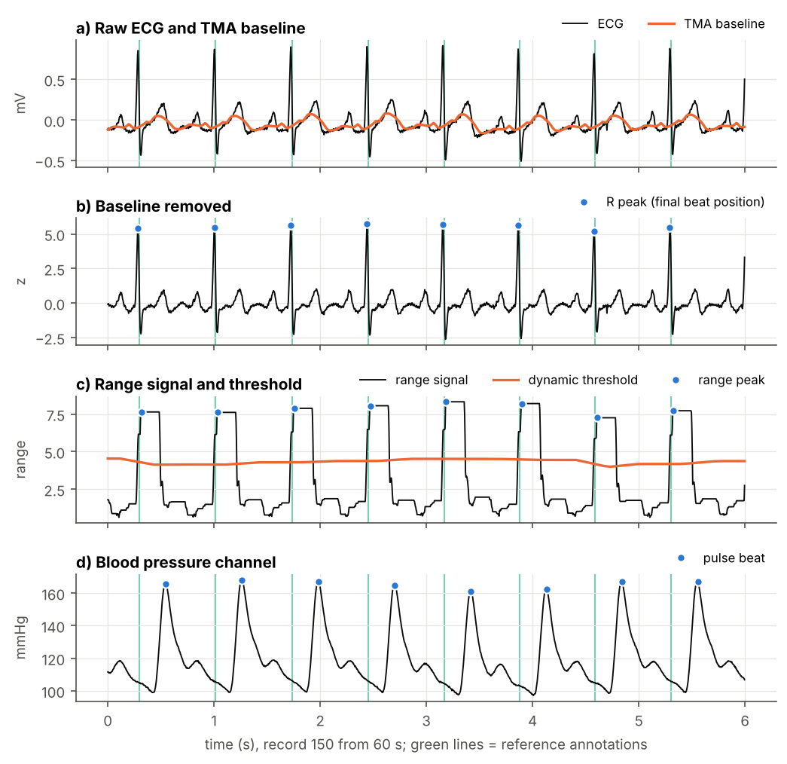
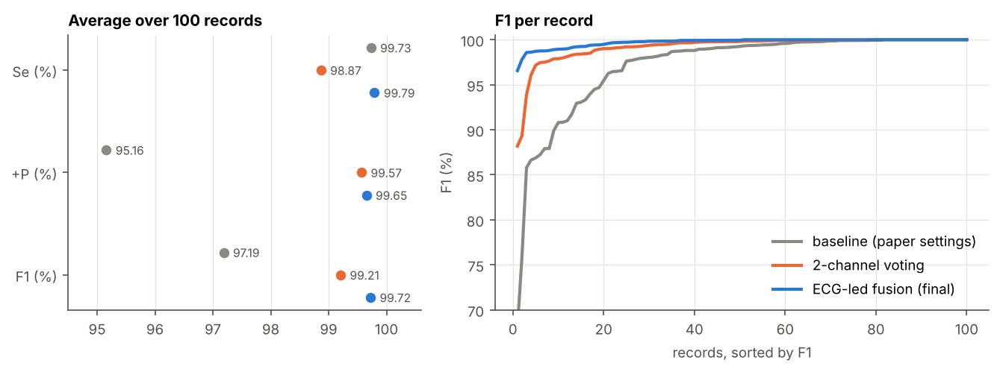
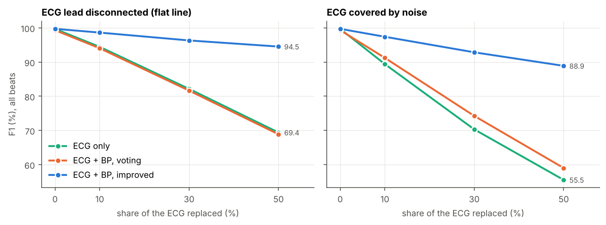
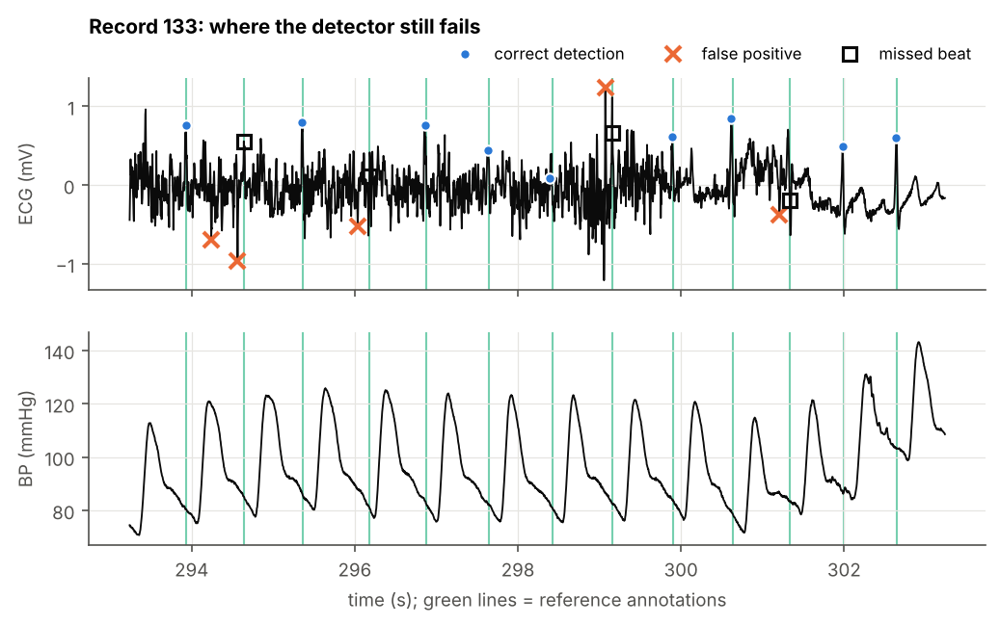

# Multimodal heartbeat detection (ECG + blood pressure)

Heartbeat detector for multi-channel bedside recordings. It finds beats in
ECG and in a pulsatile signal (arterial blood pressure), and combines both so
that output stays usable when ECG is noisy or a lead falls off.

The starting point is an algorithm by Vollmer (2014) from the
PhysioNet/Computing in Cardiology Challenge 2014: a trimmed moving average
baseline filter, a "range" signal and a dynamic threshold. I reimplemented it in
Python, then changed how beats are localised and how channels are fused.



## Results

Evaluated on all 100 records of the Challenge 2014 training set (`set-p`),
against reference annotations (`.atr`), with a 50 ms matching window.
Values are averages over records.

| Version | Se (%) | +P (%) | F1 (%) | FP | FN | Records with F1 = 100 |
|---|---:|---:|---:|---:|---:|---:|
| `baseline`: paper settings, any channel can add a beat | 99.73 | 95.16 | 97.19 | 4353 | 192 | 19 |
| `voting`: beat must be seen in 2 channels | 98.87 | 99.57 | 99.21 | 299 | 816 | 21 |
| `improved`: R peak localisation + ECG-led fusion | **99.79** | **99.65** | **99.72** | 257 | 153 | 50 |



What changed between versions:

1. **From `baseline` to `voting`.** In the baseline, every clean beat from every
   channel ends up in the output, so a single noisy pressure channel adds
   hundreds of false beats (record 149 alone has 500+). Requiring two channels
   to agree removes almost all of them, but every beat that only one channel
   catches is now lost, so sensitivity drops.
2. **R peak localisation.** The range signal looks back 200 ms, so its maximum
   comes a little after the QRS complex: typically 16 ms later, and more than
   50 ms for wide or inverted complexes. Those beats were counted as a false
   positive plus a missed beat. Each ECG beat is now moved to the largest
   absolute deflection of the filtered ECG near it (100 ms before to 50 ms after).
3. **ECG-led fusion.** Instead of a vote, the ECG is treated as the main
   channel because its timing is precise. Blood pressure beats are shifted
   back by the pulse transit time and only used where the ECG can't be trusted:
   * gaps longer than 1.5x local RR interval (missed beats, lead off),
   * 5 s windows where most ECG beats have no matching pulse beat and pulse
     rhythm is clearly more regular than the ECG one (noisy lead).

   The transit time is estimated from ECG/pulse pairs and median filtered,
   but only from windows where both channels agree, otherwise a noisy ECG
   would also spoil the delay estimate.

Small ablation on the final version: without the R peak step F1 is 99.64, so
fusion gives most of the gain over `voting` and localisation the rest.

Per-record numbers are in [`results/`](results), together with `.asc` and
WFDB `.qrs` annotation files of the final version.

### What happens when the ECG is bad

On `set-p` the ECG is clean almost everywhere, so an ECG-only detector already
gets an F1 of about 99.7 and the second channel hardly matters. To check
the fusion, I replaced part of the ECG (in 20 s blocks, after the first 30 s) with
either a flat line (lead disconnected) or white noise of the same power, and
ran the detector again on ECG + BP channels.



With half of the ECG gone, ECG-led fusion still finds 93 % of beats,
while ECG only and the voting version drop to about 53 %. With noise, voting
helps a bit with false positives, but it can't recover beats that are only
visible in the pressure signal. The script is `scripts/robustness.py`, the
numbers are in `results/robustness.csv`.

### Where it still fails



The worst record of the final version is 133 (F1 96.6). The ECG has bursts of
muscle noise that look like QRS complexes in the range signal, so the detector
picks noise spikes and the R peak step can't fix that. The pressure channel is
fine there, but the noise is not strong enough to trigger the window swap:
enough ECG beats still line up with the pulse. Some ideas for this:

* score each ECG beat separately (e.g. template correlation with the median
  beat) instead of whole 5 s windows,
* an adaptive noise threshold instead of fixed 0.4,
* use the pressure channel's own signal quality, not only RR regularity.

Also worth saying: the parameters were tuned on the same 100 records they are
evaluated on. The hidden Challenge test set is not public, so the numbers above
are optimistic for unseen data.

## Usage

Needs Python 3.10 or newer.

```bash
pip install -r requirements.txt
python scripts/download_data.py          # ~160 MB into data/set-p

# one record -> results/annotations/100.asc and 100.qrs
python scripts/detect.py data/set-p/100

# whole set, per-record CSV in results/
python scripts/evaluate.py data/set-p --preset improved --annotations results/annotations
python scripts/evaluate.py data/set-p --preset voting
python scripts/evaluate.py data/set-p --preset baseline

python scripts/robustness.py data/set-p  # takes ~5 min on 4 cores
python scripts/make_figures.py data/set-p

pytest
```

Or from Python:

```python
from heartbeat import HeartbeatDetector, get_preset

beats = HeartbeatDetector(get_preset("improved")).detect_record("data/set-p/100")
```

All parameters are in `heartbeat/config.py`.

## Project structure

```
heartbeat/
  preprocessing.py   resampling, TMA baseline filter, range signal
  detection.py       dynamic threshold, beat candidates, R peak localisation
  quality.py         channel check (ECG / pressure / unusable) from RR regularity
  fusion.py          pulse transit time correction, voting and ECG-led fusion
  detector.py        HeartbeatDetector, ties it together
  evaluation.py      beat matching, Se / +P / F1
  io.py              .asc / .qrs output
scripts/             download, detect, evaluate, robustness test, figures
tests/               unit tests (matching, fusion) and a synthetic end-to-end check
results/             per-record metrics, annotations of the final version
figures/
```

## Data

[PhysioNet/CinC Challenge 2014: Robust Detection of Heart Beats in Multimodal
Data](https://physionet.org/content/challenge-2014/1.0.0/), training set
`set-p` (100 records, most of them 10 minutes long, 250 Hz, ECG + BP + other
channels). The data is not included here, `scripts/download_data.py` fetches it.

## References

- M. Vollmer, "Robust detection of heart beats using dynamic thresholds and
  moving windows," *Computing in Cardiology*, vol. 41, pp. 569-572, 2014.
- A. L. Goldberger et al., "PhysioBank, PhysioToolkit, and PhysioNet,"
  *Circulation*, vol. 101, no. 23, 2000.

---

The first version of this was a lab assignment for a biomedical signal
processing course at the Faculty of Computer and Information Science,
University of Ljubljana. I've kept working on it since.

Licensed under MIT.
